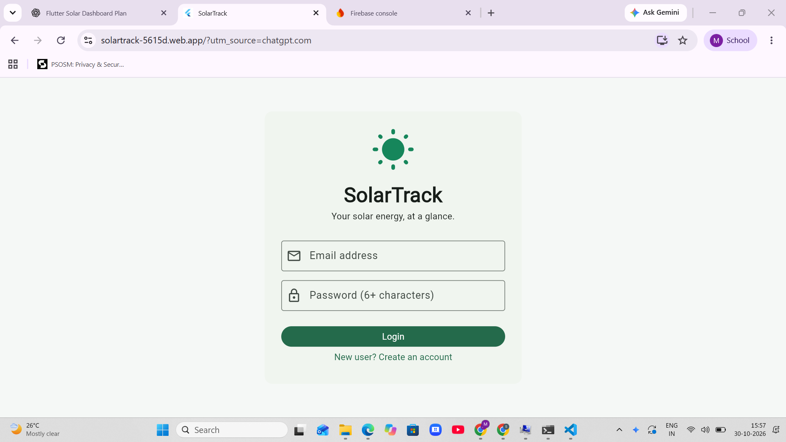
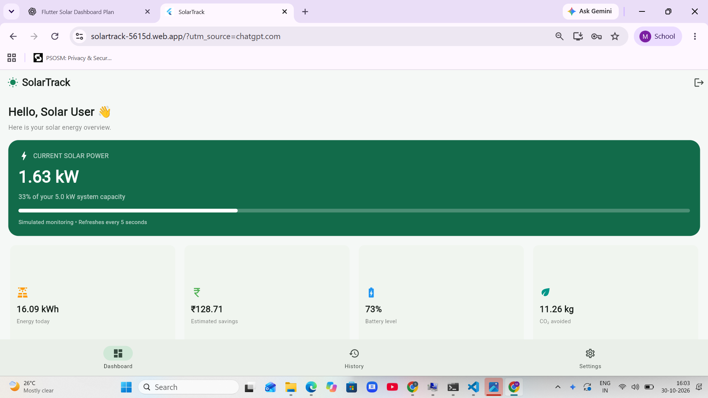
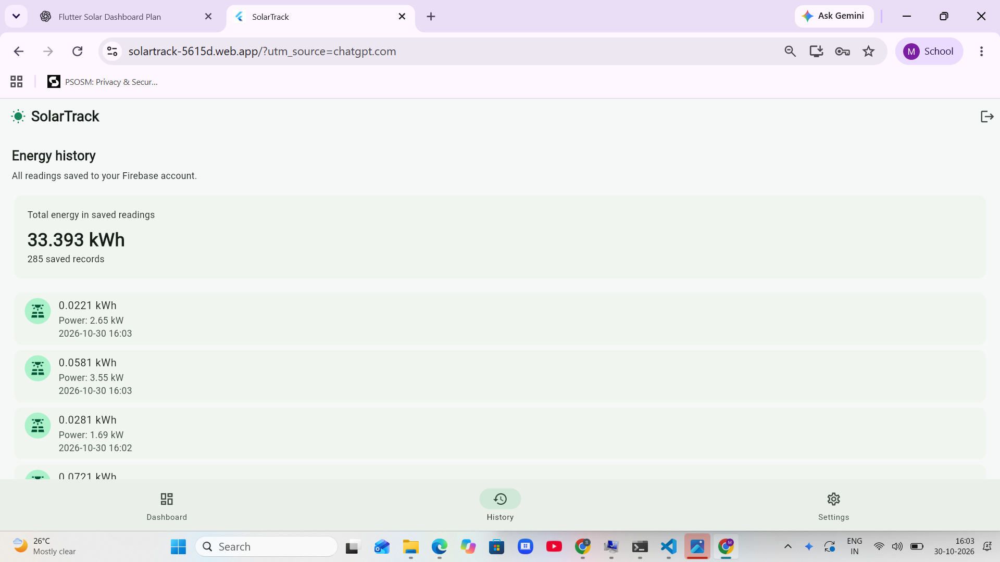
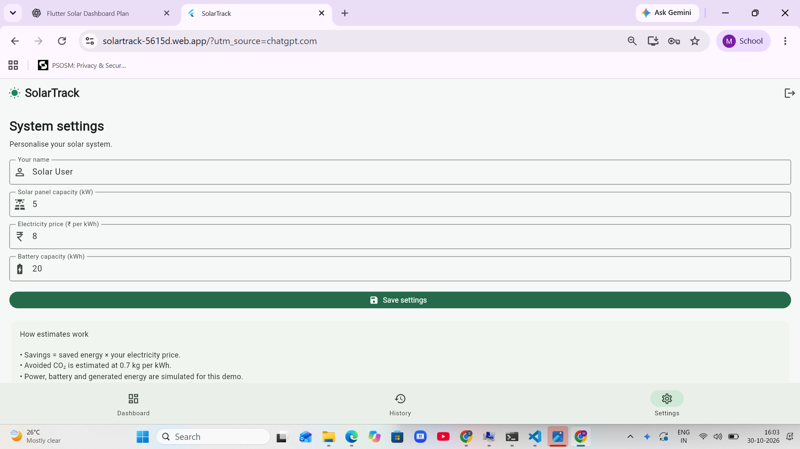

# ☀️ SolarTrack – Solar Energy Monitoring Dashboard

SolarTrack is a Flutter-based solar energy monitoring dashboard designed to help users understand and track solar energy production through a simple and user-friendly interface.

The application displays simulated solar energy readings, battery levels, estimated savings, and environmental impact.

🌐 **Live Demo:** https://solartrack-5615d.web.app

## ✨ Features

- **User Authentication:** Secure registration and login using Firebase Authentication.
- **Dashboard:** Displays solar power, battery percentage, daily energy generation, estimated savings, and CO₂ avoided.
- **Energy History:** Stores and displays previous solar readings.
- **Record Reading:** Allows users to manually record a new reading.
- **Settings:** Provides user-related settings.
- **Cloud Database:** Uses Firebase Cloud Firestore to store user information and readings.

## 🛠️ Technologies Used

- Flutter
- Dart
- Firebase Authentication
- Cloud Firestore
- Material 3

## 📱 Application Screens

- Login and Registration
- Solar Energy Dashboard
- Energy History
- Settings
  ## 📸 Screenshots
## 📸 Application Screenshots

### Login

### Dashboard

### Energy History

### Settings

## 🌱 Sustainable Development Goal

SolarTrack supports **UN Sustainable Development Goal 7 – Affordable and Clean Energy**.

It promotes awareness of renewable energy usage, energy production, and environmental benefits through an accessible digital dashboard.

## ⚙️ How to Run the Project

1. Clone this repository:

   `git clone https://github.com/NavyasriMahadevapatnam/SolarTrack-Solar-Energy-Monitoring.git`

2. Open the project folder.

3. Install dependencies:

   `flutter pub get`

4. Run the application:

   `flutter run`

For web deployment:

   `flutter build web --release`

## 📊 Project Note

This project currently uses simulated solar energy readings for demonstration and educational purposes. It is not connected to actual solar panels or physical monitoring sensors.

## 👩‍💻 Developed With

Flutter and Firebase

**SolarTrack – Making Solar Energy Monitoring Simple!**
